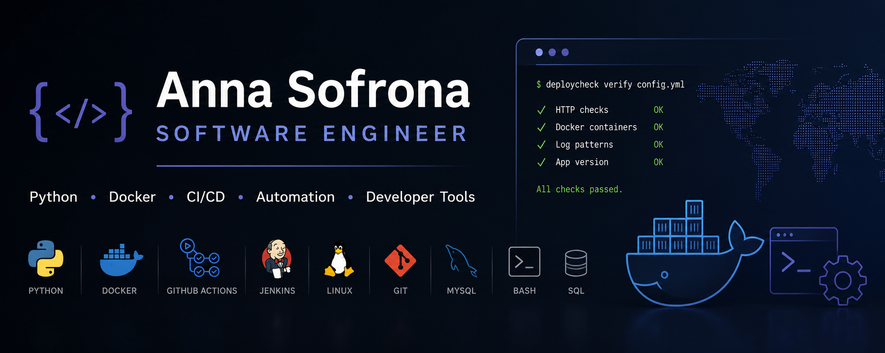

# Hi, I'm Anna 👋

I'm a **Software Engineer** with experience in building, maintaining, and supporting production applications.

My work spans **backend development, automation, CI/CD, deployment tooling, databases, and production support**, with a particular interest in improving developer workflows and automating repetitive engineering tasks.

Currently, I'm experimenting with **React Native, Expo and Claude** in order to create my first mobile app.

---

## 🚀 Featured Projects

✅ undo

A lightweight, offline-first task manager built with React Native and Expo.

undo helps you capture and manage tasks without relying on an account or cloud sync, with local storage keeping your tasks on your device.

**Key features:**

✅ Task management and organisation

* 🔒 Offline-first experience with local-only storage
* 🎙️ voice-to-text task entry
* 💬 Natural-language task entry
* 📱 Mobile app built with React Native and Expo
* 🎨 Custom UI/UX designed in Figma
* 🌐 Complementary landing page
* 🤖 AI-assisted development using Claude

Designed in Figma and developed with React Native, Expo and Claude-assisted workflows.
Soon on Google Play.

👉 [Explore the project](https://theundo.app/)
🎨 [Checkout the design](https://www.figma.com/design/obJ9UlzWMGOj4oXV5pFlDq/undo---task-manager?node-id=414-51&p=f&t=Udunnsi6BXL9xbCy-0)

### 🔎 DeployChecker

A Python CLI for automated **post-deployment verification**.

Instead of manually checking services, containers, versions, and logs after a deployment, DeployChecker runs the checks from a simple YAML configuration.

**Current checks include:**

* 🌐 HTTP health checks
* 🐳 Docker container status
* 📋 Log pattern detection
* 🏷️ Application version verification
* ⚙️ YAML-based configuration
* 🧪 Automated tests
* 🔄 GitHub Actions CI

```bash
deploycheck verify config.yml
```

Built with **Python, Typer, Rich, Pydantic, HTTPX, Docker SDK and PyYAML**.

👉 [View DeployChecker](https://github.com/lumoswitch/DeployChecker)

---

## 🛠️ Tech Stack

### Languages


### DevOps & Tooling


### Web


### Databases


---

## 💻 What I Work On

* Building and maintaining production software
* Automating deployment and validation workflows
* CI/CD pipelines and release processes
* Docker-based development and testing
* Production monitoring and troubleshooting
* SQL and database-driven applications
* Developer tooling and workflow automation

---

## 📌 Projects

### 🔎 DeployChecker

Post-deployment verification CLI built with Python.

Checks HTTP endpoints, Docker containers, logs, and deployed application versions.

[View repository →](https://github.com/lumoswitch/DeployChecker)

### 🐳 Docker Monitoring Dashboard

A lightweight dashboard for monitoring Docker containers, viewing logs, and managing container state.

Built with **FastAPI, JavaScript, Docker and WebSockets**.

[View my repositories →](https://github.com/lumoswitch?tab=repositories)

---

## 🎓 Education

**Bachelor's Degree in Computer Science**

---

## 🤝 Connect with Me

[](https://linkedin.com/in/anna-sofrona)

[](https://github.com/lumoswitch)

---

> Always interested in building tools that make development, deployments, and everyday engineering workflows simpler.


